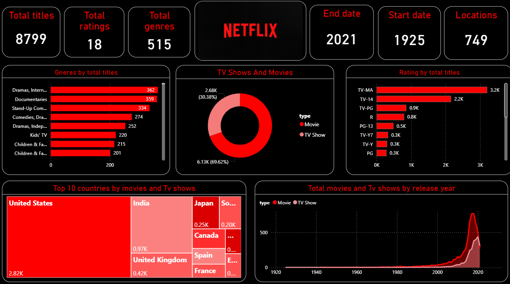

<div align="center">

# 📺 Netflix Content Dashboard (Power BI)

**What Netflix carries, where it comes from and how the catalogue grew, on one Power BI page.**




</div>

---

## 📌 Overview

A content team needs to know the mix of the catalogue: movies vs TV shows, which genres and ratings dominate, which countries supply the most titles, and how fast the library has grown. This dashboard answers those questions on a single page.

## 📂 Dataset

| | |
|---|---|
| **File** | [`data/netflix_titles.xlsx`](data/netflix_titles.xlsx) |
| **Rows** | 8,807 titles |
| **Release years** | 1925 – 2021 |
| **Columns (12)** | `show_id`, `type`, `title`, `director`, `cast`, `country`, `date_added`, `release_year`, `rating`, `duration`, `listed_in` (genres), `description` |

## 📊 KPIs

| KPI | Value |
|---|---|
| 🎬 Total titles | 8,799 |
| 🔞 Ratings | 18 |
| 🎭 Genres | 515 |
| 🌍 Locations | 749 |
| 📅 Release years | 1925 – 2021 |

## 📈 Visuals

- Genres by total titles
- TV shows vs movies (donut)
- Ratings by total titles
- Top 10 countries by titles (treemap)
- Movies and TV shows by release year (area)

## 🔍 Key Insights

- **Movies make up about 70% of the catalogue** (6.13K movies vs 2.68K TV shows).
- **The United States supplies the most titles (2.82K)**, followed by India (0.97K) and the United Kingdom (0.42K).
- **Mature content dominates:** TV-MA (3.2K) and TV-14 (2.2K) are the two largest ratings.
- **International dramas, documentaries and stand-up comedy** are the top genres by title count.
- **Content growth took off after 2015**, peaking just before 2020.

## 💡 Recommendations

- Add more TV shows to balance a movie-heavy catalogue.
- Keep investing in the strongest genres: dramas and documentaries.
- Grow content from countries beyond the US, building on India and the UK.
- Keep the mature-audience focus while exploring more family-friendly titles.

## 🛠️ Approach

1. **Prepare** the Excel dataset in Power Query.
2. **Build** KPI cards and charts for type, genre, rating, country and release year.
3. **Design** a single dark-theme page in Netflix colours for quick reading.

## 📁 Repository Structure

```
netflix-data-analysis-powerbi/
├── data/
│   └── netflix_titles.xlsx         # dataset (8,807 titles)
├── dashboard/
│   └── netflix_dashboard.pbix      # Power BI report
├── images/
│   └── dashboard.png               # dashboard screenshot
└── README.md
```

## ▶️ How to Open

1. Install [Power BI Desktop](https://powerbi.microsoft.com/desktop/) (free).
2. Open `dashboard/netflix_dashboard.pbix`.

---

## 👤 Author

**Abhishek Kumar** · MIS Data Analyst  
[LinkedIn](https://www.linkedin.com/in/abhikumar8762/) · [GitHub](https://github.com/abhishek8762a) · [Portfolio](https://abhishek-portfolio-8762.vercel.app) · [Email](mailto:abhiyadav8762@gmail.com)
